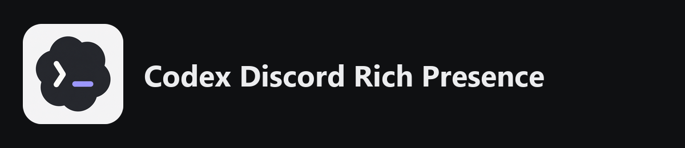
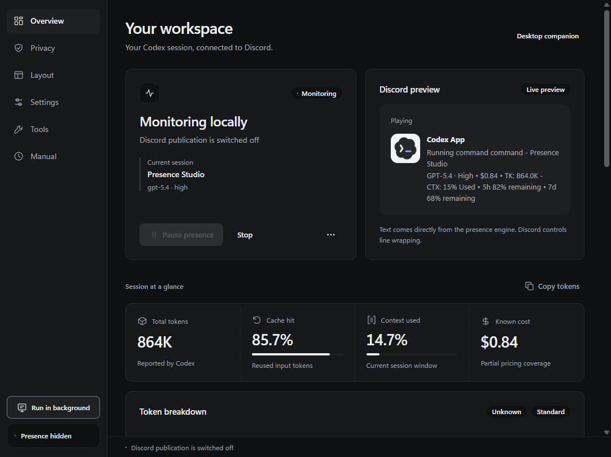
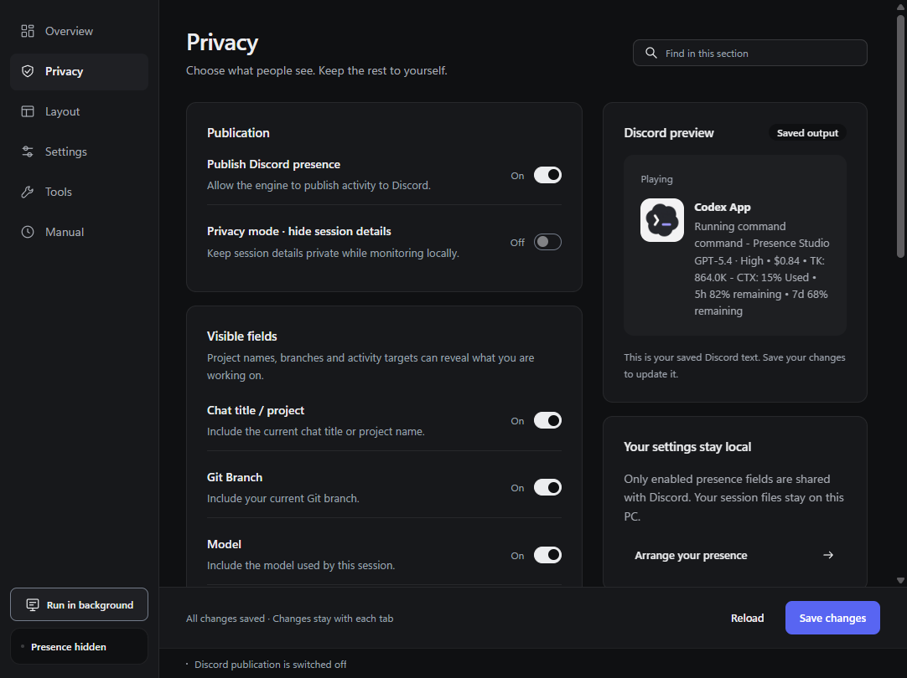
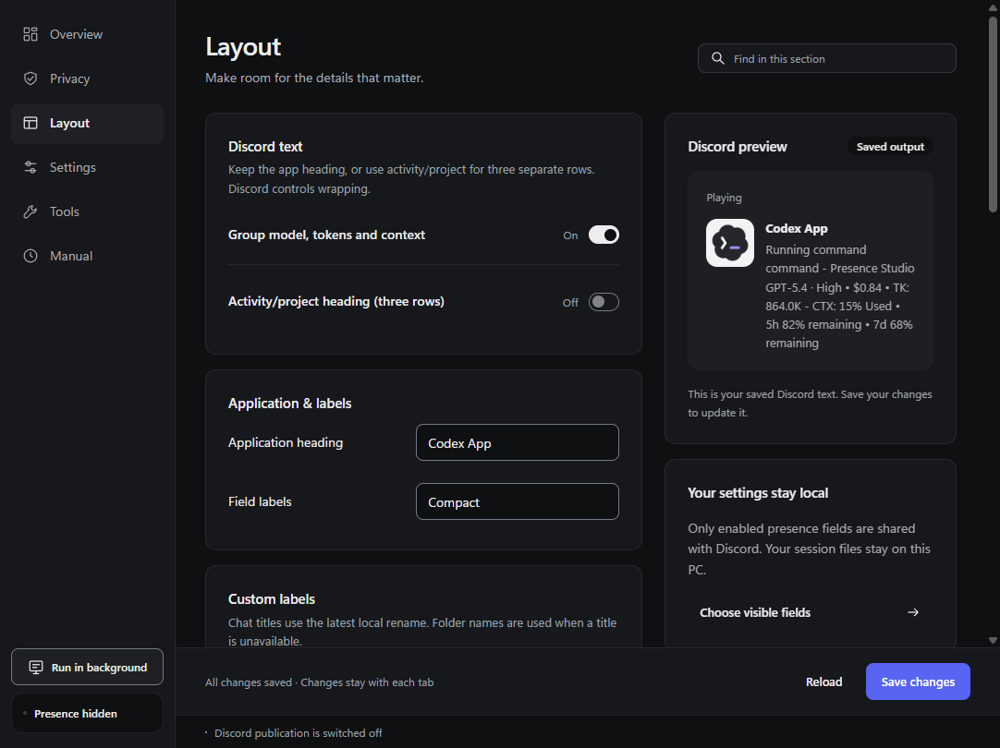
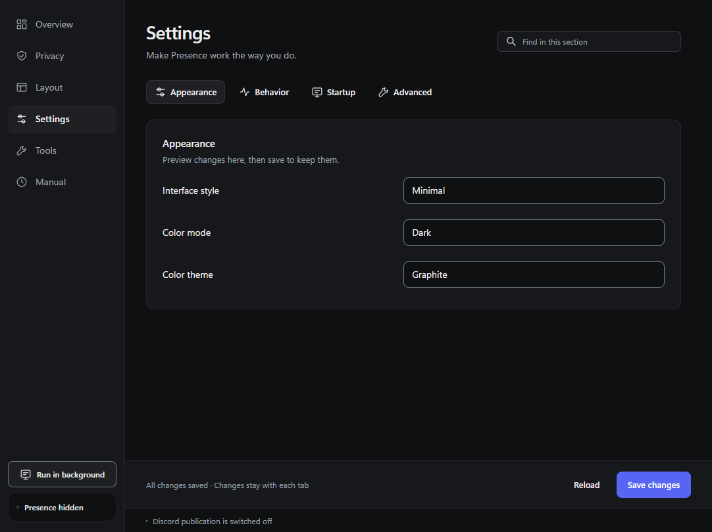
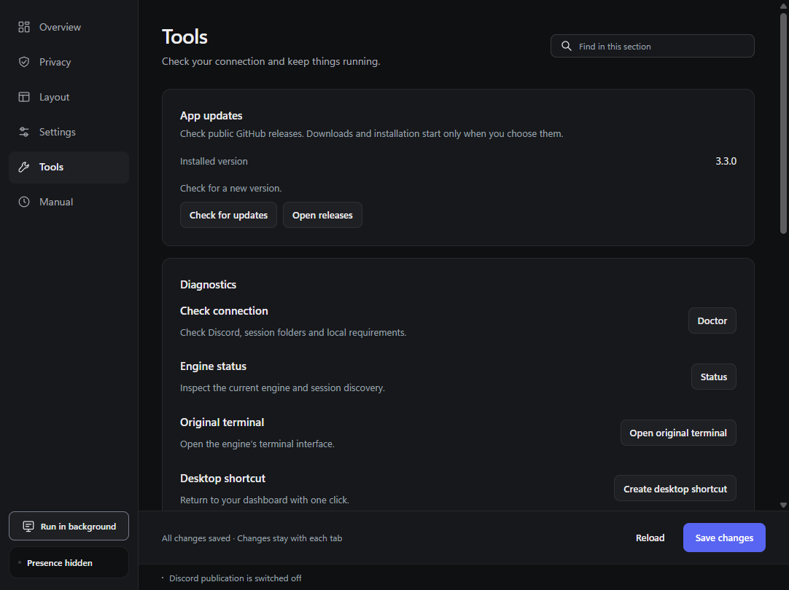
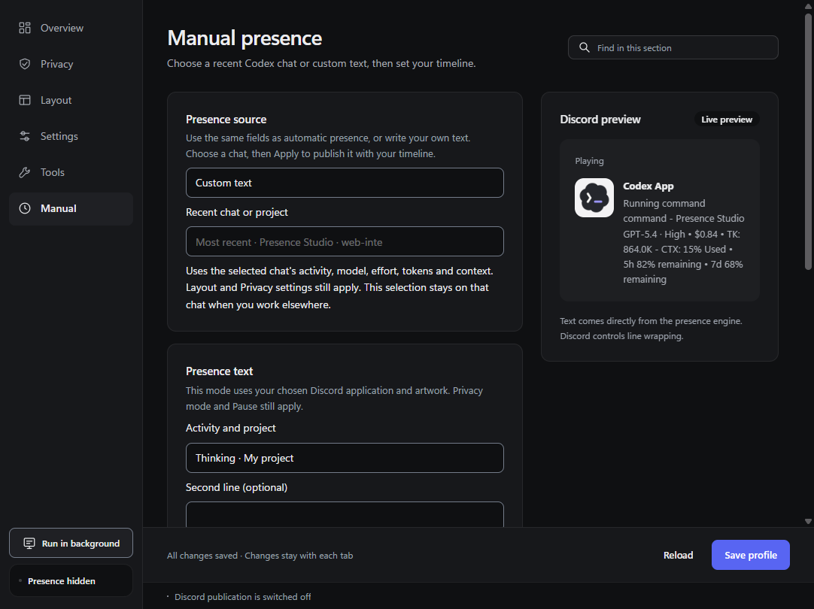

# Codex Discord Rich Presence



A compact Windows desktop utility that shows your Codex activity in Discord: chat title, model, reasoning effort, token usage, context and elapsed time.

**Created and maintained by [Wrakeeb](https://github.com/w-rakeeb).** Vibe coded with AI assistance, then checked with automated tests and local Windows runtime verification. Independent community software; not affiliated with OpenAI or Discord.

[Download for Windows](https://github.com/w-rakeeb/Codex-Discord-Rich-Presence/releases/latest) · [User guide](desktop/Guide.md) · [Report a bug](https://github.com/w-rakeeb/Codex-Discord-Rich-Presence/issues/new/choose) · [Changelog](CHANGELOG.md)



## What it does

- Detects Codex tasks already running when the companion starts. Idle startup remains hidden.
- Shows the selected chat title, model, effort and configurable usage fields.
- Supports manual recent-session presence and custom timestamps.
- Provides privacy controls, custom text, line arrangement, timer behavior and game priority.
- Runs in the background, with optional tray hiding and startup alongside Codex or ChatGPT.
- Offers dark/light appearance, several interface styles, logs, diagnostics and a terminal view.
- Checks this repository's public GitHub releases on demand. You choose when to open and install an update.
- Uses local Codex session data and Discord desktop IPC. No bot token, administrator access or telemetry service is needed.

## Install

1. Download the Windows x64 ZIP from [Releases](https://github.com/w-rakeeb/Codex-Discord-Rich-Presence/releases/latest).
2. Extract the entire folder somewhere writable. Keep the Runtime, Assets and Web folders together.
3. Install [Microsoft .NET 8 Desktop Runtime x64](https://dotnet.microsoft.com/en-us/download/dotnet/8.0) and [WebView2 Runtime](https://developer.microsoft.com/en-us/microsoft-edge/webview2/) if they are missing.
4. Open **Codex Presence.exe**, start the Discord desktop app and enable presence. Use Tools to create the desktop shortcut.
5. Start a Codex task, or reopen while a task is running. Idle sessions do not publish a startup card.

Designed for Windows 10 and 11 x64. Locally verified on Windows 11; physical Windows 10 and mixed-DPI monitor transitions have not been verified. The executable's legacy filename is retained to preserve existing shortcuts and startup settings.

## Update

Open **Tools → Check for updates**. The check contacts GitHub only when requested. It reports the installed/latest version and opens the trusted release page when you choose. It never silently downloads, replaces files or restarts the app. Exit the app before extracting an update; preserve your `Data` folder.

## Screenshots

| Privacy | Layout |
|---|---|
|  |  |

| Settings | Tools |
|---|---|
|  |  |



Screenshots use synthetic sessions, not a user's private chats.

## Build and verify

Requirements: Rust MSVC toolchain, Visual Studio C++ Build Tools, .NET 8 SDK, Node.js and npm. No extra runtime UI framework is installed.

```powershell
pwsh -File scripts/verify.ps1
dotnet run --project tests/desktop-updates/UpdateTests.csproj
pwsh -File scripts/build-desktop.ps1 -OutputDirectory D:\Build\CodexPresence
pwsh -File scripts/verify-web.ps1 -AppRoot D:\Build\CodexPresence
pwsh -File scripts/verify-desktop.ps1 -AppRoot D:\Build\CodexPresence -CrossVolume
```

| Folder | Contents |
|---|---|
| `desktop/` | WPF host, tray, settings and update checker |
| `desktop/Web/` | Local daisyUI/WebView2 interface |
| `src/`, `crates/` | Rust presence engine and core logic |
| `tests/` | Engine and update-check regression tests |
| `scripts/` | Build, verification, packaging and branding exports |
| `docs/` | Technical documentation and current screenshots |
| `assets/branding/` | Approved product artwork |

## Privacy and permissions

Presence data goes to your local Discord desktop client. The optional update check contacts GitHub; it sends no chat text, local paths, API keys or Discord credentials. Custom Discord Application IDs are public identifiers, not bot tokens. The app does not require full Discord permissions.

## License

MIT. Required third-party and inherited-code notices are retained in [LICENSE](LICENSE) and [NOTICE.md](NOTICE.md). This repository starts with a clean Git history for Wrakeeb's desktop product; that does not change the provenance or license of inherited code.
